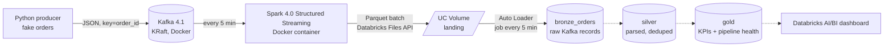

# Near-real-time e-commerce ELT on Databricks, built by an AI agent team

A learning project that streams fake e-commerce orders through **Kafka** and **Apache Spark** into **Databricks Unity Catalog**, layer by layer (bronze → silver → gold), on the way to a Databricks dashboard that shows both the business data and each engineering step.

What makes it different: it is built by a **team of Claude Code agents** — a tech-lead agent that I talk to, plus DevOps, Data Engineering and Cybersecurity specialists — and the team itself is monitored and evaluated with **open-source MLflow**.

> **Status:** Phases 0–2 done (local streaming + ingestion into Databricks bronze, verified end to end). Phase 3 (silver/gold) and Phase 4 (dashboard) are next. See [docs/ROADMAP.md](docs/ROADMAP.md).

---

## Architecture



Dotted steps are planned (Phase 3–4).

**How data moves**

1. **Producer** (`src/datalake_duckdb/producer.py`) simulates the life of an order — `created → paid → shipped → delivered`, with some `cancelled` — and sends each status change as a JSON event to the Kafka topic `orders`. About 1% of events are deliberate duplicates, so the cleaning step has something to remove.
2. **Kafka** runs locally in Docker (single broker, KRaft mode, bound to `127.0.0.1` only).
3. **Spark ingestor** (`spark/ingest_orders.py`) runs in Docker, reads Kafka every 5 minutes, and uploads each micro-batch as one Parquet file to a Unity Catalog volume. It does **not** parse the data — ELT means land raw first, transform in the warehouse.
4. **Bronze job** (`databricks/src/01_bronze.py`) is a serverless Databricks job that picks up new files with Auto Loader and appends them to `workspace.ecommerce.bronze_orders`.

**Key design decisions** (full reasoning in [docs/adr/](docs/adr/))

| Decision | Why |
|---|---|
| Spark *pushes* to Databricks instead of Databricks *pulling* from Kafka | Kafka stays private on the laptop; the only connection is outbound HTTPS. No hosted Kafka needed. |
| Micro-batches every 5 minutes ("near real time") | Matches Databricks Free Edition (serverless only) and keeps compute cost low. End-to-end latency is ~5–10 min. |
| Landing zone (volume) + Auto Loader | Standard lakehouse pattern; raw files are kept, so any layer can be rebuilt. |
| Deterministic file names per batch + Spark checkpoints | A retried batch overwrites its own file instead of duplicating data. Verified: 374 Kafka records → 374 bronze rows, no gaps, no duplicates. |
| Spark in Docker | No local Java install, and no conflict with `databricks-connect` in the Python environment. |

## Tech stack

| Area | Tools |
|---|---|
| Streaming | Apache Kafka 4.1 (KRaft), Kafka UI (kafbat), confluent-kafka (Python) |
| Processing | Apache Spark 4.0 Structured Streaming, Databricks Auto Loader |
| Lakehouse | Databricks (serverless), Unity Catalog, Delta Lake, Declarative Automation Bundles |
| Infra | Docker Compose, Make, uv (Python 3.12) |
| AI engineering | Claude Code subagents, hooks, MLflow 3 (tracking, tracing, GenAI evaluation) |
| Quality | pytest (84 tests), ruff, pip-audit, security reviews per phase |

---

## The agent team

I only talk to the **leader**. It plans, delegates, checks the work and reports back. Specialists live in [`.claude/agents/`](.claude/agents/):

| Agent | Owns | Never does |
|---|---|---|
| **Leader** ([CLAUDE.md](CLAUDE.md)) | Planning, task briefs, review, roadmap, ADRs | Large implementation work a specialist owns |
| **devops-engineer** | Docker, Kafka, Spark container, Databricks bundles and jobs, Makefile, MLflow server | Transformation logic |
| **data-engineer** | Producer, Spark ingestion code, bronze/silver/gold, tests, evals | Infra and secrets handling |
| **cybersecurity** | Reviews secrets, tokens, network exposure, dependencies, catalog grants | Editing code — it reports, the leader routes fixes |

**Rules that keep it safe:** secrets only in git-ignored `.env` files; agents are denied read access to `.env` files; the security agent must review any infra/auth/dependency change before a phase is called done; anything that costs money or touches the cloud is confirmed with me first.

The security reviews already caught real issues — for example a Databricks token pasted into `.env.example` (a file meant to be committed) was blocked before it ever reached git. Reports: [docs/security/](docs/security/).

## Monitoring and evaluating the agents (MLflow)

A local, open-source **MLflow** server (Docker, `http://127.0.0.1:5000`) watches the agent team itself. Details: [docs/observability.md](docs/observability.md).

- **Monitoring** — Claude Code hooks log, per agent and per step: tokens in/out, cache usage, tool calls, how full the context window is, and how much context was lost when the conversation gets compacted. One MLflow run per session, one nested run per agent task, plus full step-by-step traces.
- **Evals** — `make agent-evals` scores every agent task against the project's own rules with `mlflow.genai.evaluate`:

| Check | What it asks |
|---|---|
| `stays_in_lane` | Did the agent only change files it owns? |
| `reviewer_read_only` | Did the security agent only review? |
| `no_secret_exposure` | Did any agent touch a token file or leak a token? |
| `verified_work` | Did engineers run tests/validation before reporting? |
| `permission_friction` | How often were agents blocked by permissions? |
| `tool_error_rate` | How many tool calls failed? |
| `security_gate` | Was every infra change security-reviewed? |
| `roadmap_updated` | Did the leader keep the roadmap current? |

First run: 100% on secrets, read-only reviewer, verification and tool errors; the leader scored worst (doing small fixes itself instead of delegating, and one change shipped without a security review). That is exactly the feedback loop evals are for: change the agent instructions, re-run, compare.

---

## Run it locally

**Prerequisites:** Docker, [uv](https://docs.astral.sh/uv/), a Databricks workspace (Free Edition works) with the Databricks CLI or VS Code extension logged in.

```bash
uv sync                                        # Python 3.12 env
cp .env.example .env                           # then add DATABRICKS_TOKEN to .env (never to .env.example)

make kafka-up                                  # Kafka + Kafka UI + MLflow
make produce ARGS="--rate 5 --duration 120"    # stream fake orders
make consume                                   # peek at the topic

make db-setup                                  # create workspace.ecommerce + landing volume
make ingest-up                                 # Spark: Kafka -> Databricks every 5 min
make deploy && make run-bronze                 # deploy the bronze job and run it once
```

| UI | URL |
|---|---|
| Kafka UI (brokers, topics, messages) | http://127.0.0.1:8080 |
| Spark UI (while the ingestor runs) | http://127.0.0.1:4040 |
| MLflow (agent monitoring + evals) | http://127.0.0.1:5000 |

Everything stops with `docker compose down` (data is kept in Docker volumes). Run `make help` for all commands, `make test` / `make lint` for checks.

## Repository layout

```
docker-compose.yml        Kafka, Kafka UI, Spark ingestor, MLflow
docker/spark-ingestor/    Spark image (Kafka connector + databricks-sdk baked in)
src/datalake_duckdb/      fake-order producer
spark/                    Spark Structured Streaming ingestor
databricks.yml            Databricks bundle (job definitions under databricks/resources/)
databricks/src/           Databricks notebooks (bronze; silver/gold next)
observability/            MLflow hooks for agent monitoring + eval suite
tests/                    pytest suite
docs/                     roadmap, architecture decisions (adr/), security reviews, observability
.claude/                  agent definitions + project settings (permissions, hooks)
fivetran_project/         dbt project (Databricks adapter), for later modeling
```

## What's next

- **Phase 3:** silver (typed columns, dedup by `event_id`, late-event handling) and gold (orders per minute, revenue by category, status funnel, pipeline health per layer).
- **Phase 4:** Databricks AI/BI dashboard, one section per pipeline step.
- **Hardening:** service principal instead of a personal token for Spark, least-privilege grants, CI with tests + bundle validation.
- **Agents:** apply the eval findings to the agent instructions and track the scores over time.
